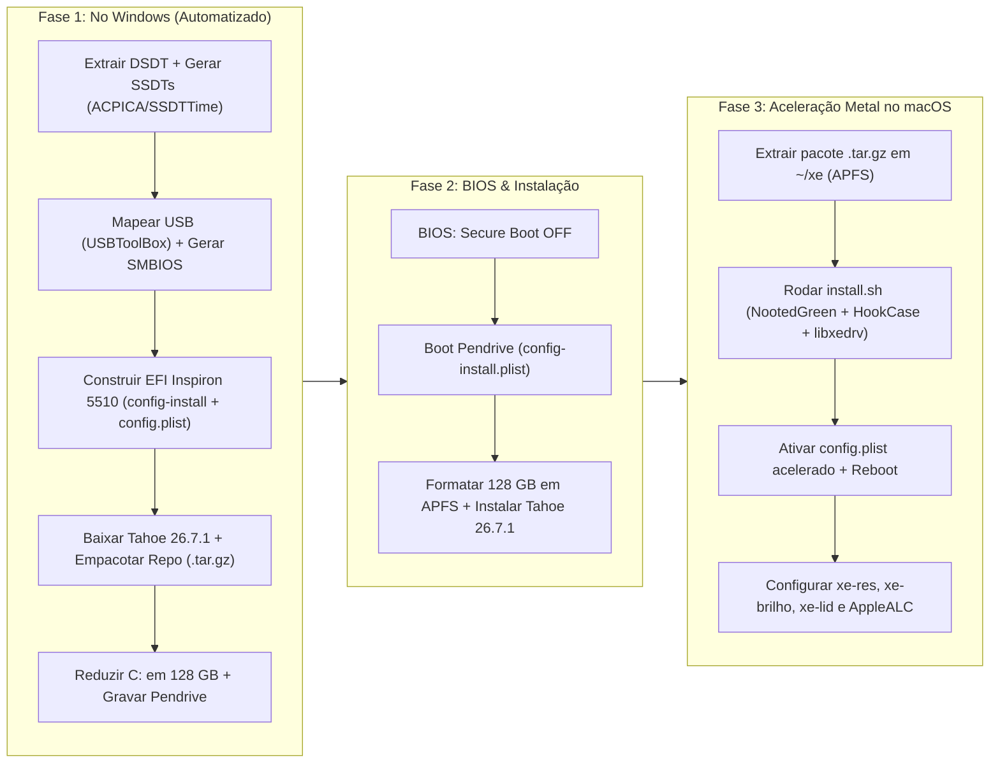

# Hackintosh no Dell Inspiron 15 5510: Design (Dual-Boot com Aceleração Iris Xe)

> Data: 2026-11-15 · Status: **Consolidado para Planejamento** · Autor: Vinic + Antigravity
> Base: [JulioNectar/Hackintosh-XPS13Plus-IrisXe-Tahoe](https://github.com/JulioNectar/Hackintosh-XPS13Plus-IrisXe-Tahoe) (commit `24450b4` de 03/11/2026, fork do NootedGreen)

---

## 1. Intenção e motivo

**Objetivo final:** usar o **macOS Tahoe 26.7.1 (25G241) como sistema principal** no Dell Inspiron 15 5510, substituindo o Windows.

**Estratégia:** implementar primeiro em **dual-boot** (macOS ao lado do Windows no mesmo SSD NVMe de 256 GB). O Windows só será removido após validação completa de estabilidade no uso diário.

**Por que este hardware é ideal para o projeto:**
1. O driver `GPUDriversIntel 16.0.32` da Apple (resgatado pelo NootedGreen e adaptado pelo JulioNectar para o macOS Tahoe 26.7.1) foi escrito especificamente para o silício **Tiger Lake-UP3/UP4 (CPU Family 6 Model 140 / `0x8C`, GPU GT2 `8086:9A49` com 96 EUs e 8 bancos L3)**.
2. Embora a Intel comercialize o **Core i5-11320H** com sufixo "H" (série H35), o levantamento de hardware provou que ele é fisicamente **Model 140 (`0x8C`, Stepping 2)** com GPU nativa **`8086:9A49` de 96 EUs** — diferente dos chips H45 (`Model 141 / 0x8D`, `9A68`) que sofrem travamentos de display na Issue #5.
3. Além disso, os commits de **03/11/2026 (`7675469` / `24450b4`)** do repositório adicionaram proteções específicas para Tiger Lake real (`XE-HWCAPS` para o divisor `0x114c` e `XE-PORTGUARD` contra panic em portas de vídeo), além do `libxedrv v24`.

---

## 2. Hardware levantado (Dell Inspiron 15 5510)

| Componente | Detalhe | ID / Caminho ACPI | Solução Tecnológica no macOS |
|---|---|---|---|
| **Modelo** | Dell Inspiron 15 5510 | SUBSYS `0B241028` | SMBIOS `MacBookPro16,2` |
| **CPU** | Intel Core i5-11320H (4C/8T, Tiger Lake H35 / UP3) | Family 6 Model 140 (`0x8C`) Stepping 2 | Spoof de CPUID no OpenCore para Ice Lake (`0x7E0606`) + `SSDT-PLUG` |
| **GPU** | Intel Iris Xe (96 EU, 8 L3 banks, Display Engine 12) | `8086:9A49` · `\_SB.PC00.GFX0` | **Nativo `9A49`** + `NootedGreen.kext` + `HookCase.kext` + `libxedrv v24` + `SSDT-PNLF` |
| **RAM** | 8 GB DDR4 (expansível via slots SO-DIMM) | - | Suportado (recomendado upgrade futuro para 16 GB) |
| **SSD** | ADATA SM2P41C3 NVMe 256 GB | `1CC1:41C3` (modo NVMe AHCI padrão) | Nativo + `NVMeFix.kext` |
| **Wi-Fi** | Intel Wi-Fi 6 AX201 160MHz | `8086:A0F0` · `\_SB.PC00.CNVW` | `AirportItlwm.kext` (build Tahoe, menu Wi-Fi nativo) |
| **Bluetooth** | Intel AX201 CNVi Bluetooth | USB interno em `\_SB.PC00.XHCI` | `IntelBluetoothFirmware.kext` + `BlueToolFixup.kext` + `IntelBTPatcher.kext` |
| **Touchpad** | Dispositivo HID I2C (`DELL0B24`) | `\_SB.PC00.I2C1.TPD0` (`A0E9`) + `\_SB.GPI0` (`INT34C5`) | `VoodooI2C.kext` (com `VoodooGPIOTigerLakeLP` corrigido) + `VoodooI2CHID.kext` + `SSDT-I2C1.aml` |
| **Teclado** | Teclado interno PS/2 | ACPI PS/2 | `VoodooPS2Controller.kext` + `BrightnessKeys.kext` |
| **USB / TB4** | PCH XHCI (`8086:A0ED`) + TB4 XHCI (`8086:9A13`) + TB4 (`9A1B`) | `\_SB.PC00.XHCI` e `\_SB.PC00.TXHC` | `USBToolBox.kext` + `UTBMap.kext` gerado sob medida no Windows |
| **Áudio Interno** | Realtek ALC236 + Intel Smart Sound (`8086:A0C8`) | `10EC:0236` · `\_SB.PC00.HDAS` | `AppleALC.kext` (layouts `3, 11, 13, 15, 54, 99` para alto-falante/fone; DMIC interno inativo devido ao SST) |
| **Áudio USB** | USB PnP Audio Device | `0C76:161E` | Nativo (AppleUSBAudio — garante microfone e saída de som desde o 1º boot) |

---

## 3. Tecnologias e Ferramentas que Utilizaremos

### 3.1. No Windows (Fase de Construção e Preparação)
1. **ACPICA (`acpidump.exe` + `iasl.exe`) & SSDTTime (Python):** Para extrair a tabela `DSDT.aml` real da BIOS do seu Dell Inspiron 15 5510 e compilar automaticamente as tabelas ACPI (`SSDT-EC`, `SSDT-PLUG`, `SSDT-PNLF`, `SSDT-RTCAWAC`, `SSDT-USBX`, `SSDT-XOSI` e `SSDT-I2C1`).
2. **USBToolBox (Windows CLI):** Para mapear todas as portas físicas dos controladores `XHCI` (`A0ED`) e `TXHC` (`9A13`) diretamente no Windows e gerar a `UTBMap.kext` respeitando o limite de 15 portas do macOS.
3. **OpenCore 1.0.8 (`OpenCorePkg`) & `macserial.exe` (GenSMBIOS):** Bootloader UEFI oficial e gerador de números de série exclusivos para o SMBIOS `MacBookPro16,2`.
4. **Python 3 + `gibMacOS` / `macrecovery.py` + `PlistLib`:**
   - Manipulação programática e validação sem erros dos arquivos `config-install.plist` e `config.plist`.
   - Download do instalador/recovery do **macOS Tahoe 26.7.1 (25G241)**.
5. **Empacotador Offline (`.tar.gz`):** Empacota o repositório `Hackintosh-XPS13Plus-IrisXe-Tahoe` e os bundles `16.0.32` do `NootedGreen` em um arquivo `.tar.gz` único, evitando que a partição FAT32 do pendrive crie arquivos `._` que quebram a assinatura de código (`codesign`) no macOS.

### 3.2. No Bootloader (OpenCore 1.0.8 EFI)
- **Drivers UEFI:** `OpenRuntime.efi`, `HfsPlus.efi` (de `OcBinaryData`), `OpenCanopy.efi`, `ResetNvramEntry.efi`.
- **Kexts Essenciais:** `Lilu.kext`, `VirtualSMC.kext` (+ `SMCBatteryManager`, `SMCProcessor`, `SMCDellSensors`), `WhateverGreen.kext` (no boot de instalação) / `NootedGreen.kext` (no boot acelerado), `NVMeFix.kext`, `RestrictEvents.kext`, `AppleALC.kext`, `AirportItlwm.kext`, `IntelBluetoothFirmware.kext`, `BlueToolFixup.kext`, `IntelBTPatcher.kext`, `VoodooPS2Controller.kext`, `VoodooI2C.kext` + `VoodooI2CHID.kext`, `USBToolBox.kext` + `UTBMap.kext`, `BrightnessKeys.kext`.
- **Removidos em relação ao XPS 13 Plus:** `CpuTopologyRebuild.kext` (desnecessário porque o i5-11320H tem 4 núcleos homogêneos e não híbridos P+E), `SSDT-XPS-I2C.aml` e `UTBDefault.kext` do XPS.

### 3.3. No macOS Tahoe 26.7.1 (Pós-Instalação e Aceleração)
- **Kernel Stack:** `NootedGreen.kext` (compilado da árvore `src/NootedGreen` commit `24450b4`) + `HookCase.kext` (`8.0.1`) + kexts `AppleIntelTGLGraphics*` (`16.0.32`) em `/Library/Extensions`.
- **User-Space Stack:** `AppleIntelTGLGraphicsMTLDriver.bundle` (patcheado via `patch-mtl17.py`), `libxedrv.dylib` (v24), `compiler-adapter` + `llvm-bridge` (LLVM 3902 → 32023) e `AppleIntelTGLGraphicsVADriver.bundle` (decodificação H.264/HEVC por hardware).
- **Utilitários de Sistema:** `xe-res` (HiDPI/resolução), `xe-brilho` + `XeShim` (controle de brilho), `xe-lid` + `10-pmset-safe.sh` (desligar tela ao fechar tampa sem travar em S3 sleep), `xe-temp` (monitoramento térmico na barra de menus).

---

## 4. Decisões Consolidadas (Propostas Padrão para Execução)

Para destravar o planejamento imediato a partir do seu ambiente atual (Windows), adotamos as seguintes decisões padrão (que você pode ajustar a qualquer momento):

1. **Criação 100% pelo Windows + Fixação da Versão 26.7.1 (25G241):**
   - *Chamada técnica:* Usaremos scripts Python no Windows para consultar o catálogo da Apple (`sucatalog`) / `gibMacOS` buscando especificamente o pacote do **macOS Tahoe 26.7.1 (build 25G241)**. Caso a Apple forneça apenas o Recovery online pelo Windows (`macrecovery.py`), validaremos o `BuildVersion` do `BaseSystem.chunklist` antes de gravar no pendrive.
2. **Divisão do SSD de 256 GB (Dual-Boot 50/50):**
   - *Chamada técnica:* O volume `C:` (atualmente com 254,9 GB totais e ~189,7 GB livres) será reduzido em **128 GB**, deixando **~126,9 GB para o Windows** (quase o dobro do que ele ocupa hoje) e **128 GB dedicados para a nova partição APFS do macOS**.
3. **Configuração de Boot-Args para Tiger Lake Nativo (`0x8C`, `9A49`, 96 EU):**
   - *No `config-install.plist` (Fase de instalação, modo VESA seguro):*
     `-v keepsyms=1 debug=0x100 -igfxvesa amfi_get_out_of_my_way=1` (`NootedGreen.kext` desativado, `WhateverGreen.kext` ativo em modo VESA).
   - *No `config.plist` (Fase acelerada com Metal 2, linha base recomendada pelo autor na Issue #5 para Tiger Lake real):*
     `-v keepsyms=1 debug=0x100 IGLogLevel=3 -ngreentglwithgfx -allow3d -disablegfxfirmware ngreenSched=4 -ngreenxefix gfxrst=1 amfi_get_out_of_my_way=1 alcid=11`
     *(Sem `ngreen-dmc=adlp` e sem `-ngreenpm` inicialmente, pois o chip é Tiger Lake-UP3 nativo de 4 núcleos homogêneos e 96 EUs).*

---

## 5. Arquitetura do Fluxo de Execução

